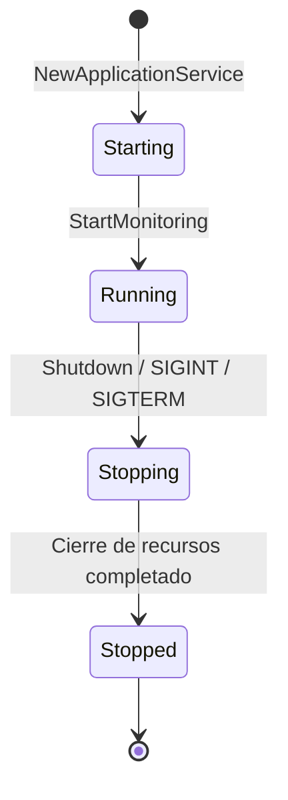

# Arquitectura del Backend en Go

Este documento describe la arquitectura interna, responsabilidades de los componentes, modelos de concurrencia y ciclos de vida del backend de monitoreo y grabación de directos de Douyin.

---

## 1. Visión General de Componentes

La arquitectura está diseñada según los principios de bajo acoplamiento y alta cohesión, separando la lógica de dominio, la supervisión de procesos del sistema operativo, el acceso a la plataforma externa y la distribución de eventos.

```
+---------------------------------------------------------------------------------+
|                               cmd/recorder/main.go                              |
|   (Manejo de CLI, señales OS SIGINT/SIGTERM, configuración inicial y logger)   |
+---------------------------------------------------------------------------------+
                                         |
                                         v
+---------------------------------------------------------------------------------+
|                               Application Service                               |
|                     (Fachada estable expuesta a la aplicación)                 |
+---------------------------------------------------------------------------------+
               |                                 |                       |
               v                                 v                       v
+-----------------------------+   +-----------------------------+   +-------------+
|       Monitor Manager       |   |      Recording Manager      |   | EventBroker |
| (Coordinación de monitores, |   |  (Control de sesiones de    |   | (Pub/Sub en |
| reglas de inicio automático)|   |   grabación y concurrencia) |   |  memoria)   |
+-----------------------------+   +-----------------------------+   +-------------+
        |                  |                     |
        v                  |                     v
+----------------+         |              +-----------------------------+
|  User Monitor  |         |              |      Recording Session      |
|  (Goroutine    |         |              | (Progreso out_time_us,      |
|   independiente|         |              |  watchdogs, pipeline)       |
|   por usuario) |         |              +-----------------------------+
+----------------+         |                             |
        |                  |                             v
        v                  v              +-----------------------------+
+-----------------------------------+     |       Process Runner        |
|           Douyin Client           |     | (Pipes Unix, grupos pgid,   |
| (HTTP REST con timeouts y headers)|     |  señales SIGTERM/SIGKILL)   |
+-----------------------------------+     +-----------------------------+
```

---

## 2. Responsabilidades Detalladas

### 2.1 Application Service (`internal/app/service.go`)
- Actúa como la fachada unificada para toda la lógica de negocio.
- Implementa la interfaz `Service`, que expone operaciones de alto nivel:
  - `GetGlobalStatus`: Obtención de una instantánea atómica del estado (`GlobalStatus`).
  - `GetUserStatus`: Consulta del estado individual de un usuario.
  - `SetAutoRecord`: Actualización de la preferencia de grabación automática.
  - `StartRecording`: Solicitud manual de inicio de grabación.
  - `StopRecording`: Detención controlada de una grabación activa.
  - `StartMonitoring`: Inicio del ciclo de monitoreo.
  - `Shutdown`: Apagado coordinado e idempotente.
  - `Subscribe`: Suscripción a eventos con entrega no bloqueante y recepción de instantánea inicial.
  - `ReloadUsers`: Sincronización dinámica de usuarios desde `user_list.txt`.
  - `AddUser`: Validación, persistencia y registro de un nuevo usuario.
  - `GetSettings` / `UpdateSettings`: Consulta y actualización de la carpeta de grabaciones, la calidad y el archivo de usuarios, persistiendo los cambios en `settings.json`.
- No depende de stdout ni de interfaces de red o IPC. La UI nativa (`internal/gui`) consume la fachada directamente y el modo CLI conserva el adaptador de consola.

### 2.2 Monitor Manager (`internal/monitor/manager.go`)
- Mantiene el registro de los monitores de usuario en memoria.
- Actúa como la **única autoridad lógica** para evaluar si debe iniciarse una grabación automática.
- Recibe notificaciones de directos (`OnLiveDetected`) y valida:
  1. Si el usuario tiene habilitado `ShouldRecord`.
  2. Si no existe ya una sesión activa para ese usuario en `RecordingManager`.
- Coordina la sincronización de usuarios (`SyncUsers`): detecta nuevos usuarios, modificaciones de alias o bandera de grabación, y usuarios eliminados (sin interrumpir grabaciones que ya estén en curso).

### 2.3 User Monitor (`internal/monitor/user_monitor.go`)
- Cada usuario monitorizado cuenta con su propia goroutine y ciclo con `time.Ticker`.
- Consulta la plataforma mediante `douyin.Client`.
- Maneja errores de forma aislada: una consulta lenta o fallida para un usuario no bloquea a los demás.
- **Distingue fallos temporales de desconexión**: si la API de Douyin devuelve un error de red o timeout, el estado se mantiene en el último conocido (no se asume erróneamente `offline`), registrando el mensaje de error en `LastQueryError`.

### 2.4 Recording Manager y Session (`internal/recorder/`)
- `RecordingManager`:
  - Garantiza que **nunca existan dos sesiones simultáneas** para un mismo usuario mediante un mapa protegido por `sync.RWMutex`.
  - Inicia y supervisa sesiones tanto automáticas como manuales.
  - Genera el resumen formateado (`Summary()`) para logging y monitoreo.
  - Coordina el apagado concurrente de todas las sesiones activas.
- `Session`:
  - Encapsula el ciclo de vida de una grabación individual.
  - Inicia la cadena de procesos: `streamlink` como productor y `ffmpeg` como consumidor.
  - Supervisa el progreso leyendo las líneas `out_time_us=<valor>` emitidas por `-progress pipe:1` de `ffmpeg`.
  - **Confirmación de inicio**: El estado pasa de `starting` a `recording` únicamente cuando `ffmpeg` reporta el primer avance positivo de tiempo multimedia.
  - **Watchdogs**:
    - Si en `starting` no hay progreso dentro de `StartupTimeout` (60s por defecto), cancela la sesión por falta de progreso inicial.
    - Si en `recording` no se reciben actualizaciones durante `InactivityTimeout` (120s por defecto), cancela la sesión por interrupción del stream.
  - En caso de terminación prematura de cualquiera de los procesos, inicia inmediatamente el cierre coordinado del otro.

### 2.5 Process Runner (`internal/recorder/process_runner.go`)
- Encapsula la interacción con el sistema operativo Linux mediante `os/exec` y `syscall`.
- **Aislamiento en grupos de procesos**: Cada proceso se inicia con `Setpgid: true` (`SysProcAttr`), garantizando que señales como SIGTERM o SIGKILL se envíen a `-pid`, terminando limpiamente a los hijos o subprocesos y evitando procesos huérfanos.
- **Gestión de pipes Unix**:
  - Conecta `producer.Stdout` con `consumer.Stdin` usando `os.Pipe()`.
  - El proceso padre cierra sus descriptores locales tras el arranque de ambos hijos; de este modo, cuando el productor finaliza, el pipe se cierra por completo y el consumidor recibe `EOF`.
  - Conecta el stdout del consumidor a un pipe de progreso para el análisis en tiempo real.
- **Secuencia de finalización ordenada**:
  1. Envía `SIGTERM` al grupo del productor (`streamlink`) y espera hasta `ProducerStopTimeout` (5s).
  2. Si no confirma su salida, escala a `SIGKILL` y espera hasta `KillTimeout` (5s).
  3. El cierre del productor envía `EOF` al consumidor (`ffmpeg`), permitiéndole volcar sus buffers y escribir los metadatos finales del contenedor MP4 (`+faststart`) hasta `FinalizeTimeout` (30s).
  4. Si el consumidor no termina dentro del plazo, se le envía `SIGTERM`, y en caso extremo `SIGKILL`.
  5. Cierra descriptores y libera los recursos.

### 2.6 Event Broker (`internal/app/events.go`)
- Mecanismo pub/sub en memoria con canales tipados.
- **Manejo de contrapresión (Backpressure)**: Los canales de suscripción tienen un buffer configurable. Si un suscriptor lento llena su buffer, los eventos no críticos se descartan para ese suscriptor incrementando un contador de descartes, sin bloquear jamás las goroutines de monitoreo o grabación.
- Los suscriptores pueden recuperar la coherencia solicitando una nueva instantánea (`GetGlobalStatus`).

---

## 3. Modelo de Concurrencia y Sincronización

1. **Goroutines aisladas**: Cada monitor de usuario y cada sesión de grabación avanzan en su propia goroutine.
2. **Contextos y cancelación**: Toda operación de I/O y ciclo de vida acepta un `context.Context`. La cancelación de un contexto padre (por ejemplo por `SIGINT`) se propaga en cascada.
3. **Protección de estado**: Las estructuras compartidas utilizan `sync.RWMutex` con secciones críticas mínimas.
4. **Verificación de condiciones de carrera**: El código se valida sistemáticamente con el detector de carreras de Go (`go test -race ./...`).

---

## 4. Ciclos de Vida del Backend



### 4.1 Ciclo de Vida del Backend
1. **Inicio (`Starting`)**:
   - Validación de argumentos y binarios en PATH (`streamlink`, `ffmpeg`).
   - Verificación y creación del directorio de salida.
   - Carga y validación estricta de `user_list.txt`.
   - Inicialización de componentes internos.
2. **Ejecución (`Running`)**:
   - Monitores activos consultando periódicamente en paralelo.
   - Detección de directos e inicio de grabaciones automáticas o manuales.
   - Relectura periódica de `user_list.txt` por rondas (conservando la configuración anterior si el archivo es temporalmente inválido).
   - Publicación continua de eventos.
3. **Apagado (`Stopping` -> `Stopped`)**:
   - Detención de nuevos inicios y cancelación de monitores.
   - Envío de órdenes de cierre a todas las sesiones de grabación en paralelo.
   - Espera con plazo límite (`FinalizeTimeout` / contexto global).
   - Cierre de canales y broker de eventos.
   - El método `Shutdown` es **idempotente** (protegido con `sync.Once`), seguro ante llamadas concurrentes o múltiples señales.
