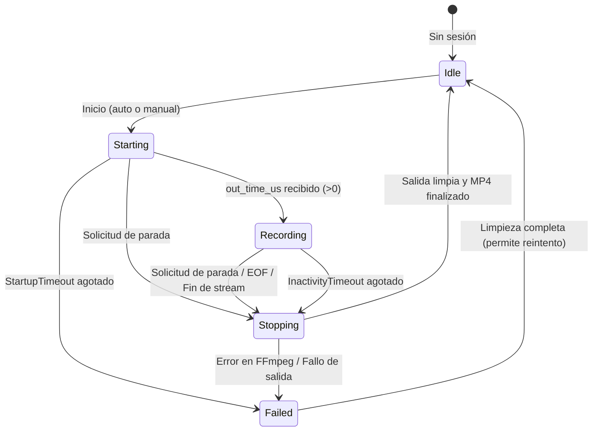

# Modelos de Estado y Contrato Interno de Eventos

Este documento detalla los modelos de dominio, las máquinas de estado y el contrato tipado de eventos utilizado internamente por el backend en Go.

---

## 1. Modelos de Estado

El sistema separa explícitamente tres dimensiones de estado:
1. **Configuración deseada**: Definida por el usuario (`ShouldRecord`, `Alias`).
2. **Estado observado de la plataforma**: Detección del directo (`LiveState`).
3. **Estado real de los procesos**: Ejecución de las herramientas externas (`RecordingState`).

### 1.1 Estado del Usuario (`domain.UserStatus`)

Representa la situación completa de un usuario monitorizado:

| Campo | Tipo | Descripción |
|---|---|---|
| `ID` | `string` | Identificador único numérico del usuario en Douyin. |
| `Alias` | `string` | Nombre legible asignado en `user_list.txt`. |
| `LiveState` | `LiveState` | Estado en directo: `"unknown"`, `"offline"`, `"live"`. |
| `RoomID` | `string` | Identificador de sala del directo activo (vacío si offline). |
| `LastQuerySuccess` | `*time.Time` | Fecha/hora de la última consulta exitosa a la plataforma. |
| `LastQueryError` | `string` | Mensaje del último error de consulta (vacío si exitoso). |
| `AutoRecordEnabled` | `bool` | Preferencia de grabación automática para este usuario. |
| `RecordingState` | `RecordingState` | Estado del grabador: `"idle"`, `"starting"`, `"recording"`, `"stopping"`, `"failed"`. |
| `ActiveSessionID` | `string` | ID de la sesión de grabación actualmente vinculada. |

> [!IMPORTANT]
> **Preservación del estado ante errores**: Si una consulta a la API de Douyin falla por problemas de red o tiempo de espera, `LiveState` **no** cambia a `"offline"`. Se conserva el último estado conocido y se registra el error en `LastQueryError`.

---

### 1.2 Estado de Grabación (`domain.RecordingState`)

Describe el ciclo de vida de una sesión de grabación:



- **`idle`**: No existe grabación activa para este usuario.
- **`starting`**: Procesos de `streamlink` y `ffmpeg` lanzados; a la espera del primer frame o paquete (`out_time_us`).
- **`recording`**: `ffmpeg` ha confirmado el avance multimedia; la sesión está escribiendo activamente el archivo MP4.
- **`stopping`**: Se ha iniciado la secuencia de terminación ordenada (se detiene Streamlink para enviar EOF a FFmpeg).
- **`failed`**: La sesión no pudo arrancar, expiró por inactividad o alguno de los procesos terminó con error irrecuperable.

---

### 1.3 Estado Global del Backend (`domain.GlobalStatus`)

Instantánea atómica exportada para consumo directo o futura integración con la GUI de Qt:

```go
type GlobalStatus struct {
    State            BackendState           `json:"state"`
    Users            []UserStatus           `json:"users"`
    ActiveRecordings []RecordingSessionInfo `json:"active_recordings"`
    Timestamp        time.Time              `json:"timestamp"`
}
```

Estados posibles del backend (`BackendState`):
- `starting`: Inicialización de configuración y registro de usuarios.
- `running`: Monitores en ejecución y servicio plenamente operativo.
- `stopping`: Cierre ordenado de sesiones y detención de monitores en progreso.
- `stopped`: Todos los recursos cerrados y procesos finalizados.

---

## 2. Contrato Interno de Eventos

Los eventos se definen como **estructuras fuertemente tipadas** en Go (no cadenas JSON sin estructurar en la lógica de negocio). Todos implementan la interfaz `Event`:

```go
type Event interface {
    Type() EventType
    Timestamp() time.Time
}
```

### 2.1 Catálogo de Eventos

| EventType | Estructura Go | Momento de Emisión |
|---|---|---|
| `user_status_changed` | `UserStatusChangedEvent` | Cambio en el estado de streaming (`offline` <-> `live`), cambio de alias, de preferencia o de sala. |
| `recording_started` | `RecordingStartedEvent` | Primer reporte de avance multimedia (`out_time_us`) confirmado por FFmpeg. |
| `recording_stopping` | `RecordingStoppingEvent` | Comienzo de la detención ordenada de una sesión de grabación. |
| `recording_stopped` | `RecordingStoppedEvent` | Sesión de grabación finalizada con éxito y archivo MP4 completado. |
| `recording_failed` | `RecordingFailedEvent` | Fallo de arranque, corte prolongado de señal o error de salida de procesos. |
| `configuration_changed` | `ConfigurationChangedEvent` | Modificación de usuarios o recarga exitosa de `user_list.txt`. |
| `monitor_error` | `MonitorErrorEvent` | Fallo temporal de consulta en la API de la plataforma para un usuario. |
| `backend_status_changed` | `BackendStatusChangedEvent` | Transición de estado del backend (`starting`, `running`, `stopping`, `stopped`). |

---

### 2.2 Estructura Detallada de los Eventos

```go
type UserStatusChangedEvent struct {
    BaseEvent
    UserID   string            `json:"user_id"`
    Alias    string            `json:"alias"`
    Previous domain.UserStatus `json:"previous"`
    Current  domain.UserStatus `json:"current"`
}

type RecordingStartedEvent struct {
    BaseEvent
    Session domain.RecordingSessionInfo `json:"session"`
}

type RecordingStoppingEvent struct {
    BaseEvent
    Session domain.RecordingSessionInfo `json:"session"`
}

type RecordingStoppedEvent struct {
    BaseEvent
    Session domain.RecordingSessionInfo `json:"session"`
}

type RecordingFailedEvent struct {
    BaseEvent
    Session domain.RecordingSessionInfo `json:"session"`
    Reason  string                      `json:"reason"`
}

type ConfigurationChangedEvent struct {
    BaseEvent
    Users    []domain.UserConfig `json:"users"`
    Settings config.Settings     `json:"settings"`
}

type MonitorErrorEvent struct {
    BaseEvent
    UserID string `json:"user_id"`
    Alias  string `json:"alias"`
    Error  string `json:"error"`
}

type BackendStatusChangedEvent struct {
    BaseEvent
    Previous domain.BackendState `json:"previous"`
    Current  domain.BackendState `json:"current"`
}
```

---

## 3. Mecanismo de Suscripción e Instantánea

Para que un futuro adaptador de transporte (IPC con Qt, WebSocket o CLI) consuma eventos sin acoplar el núcleo:

```go
eventCh, unsubscribe, initialSnapshot := service.Subscribe(ctx, bufferSize)
```

1. **Instantánea inicial**: El suscriptor recibe el estado global completo en el momento exacto de la suscripción, garantizando que no existan lagunas de información inicial.
2. **Entrega no bloqueante**: Si el consumidor es lento y llena el buffer del canal, los eventos se descartan para ese suscriptor evitando congelar la lógica de monitoreo y grabación.
3. **Resincronización**: En caso de retraso o desconexión, el consumidor puede llamar a `GetGlobalStatus(ctx)` para reconstruir su estado de manera fiable.
